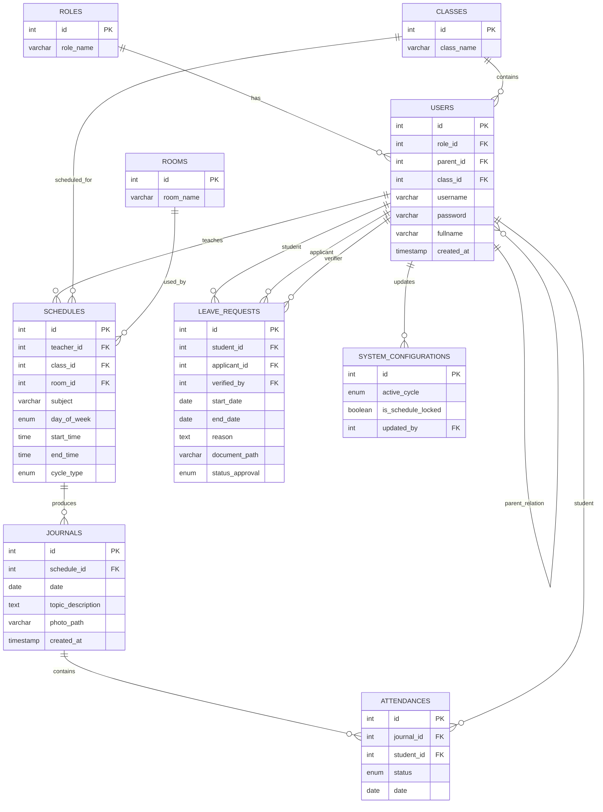
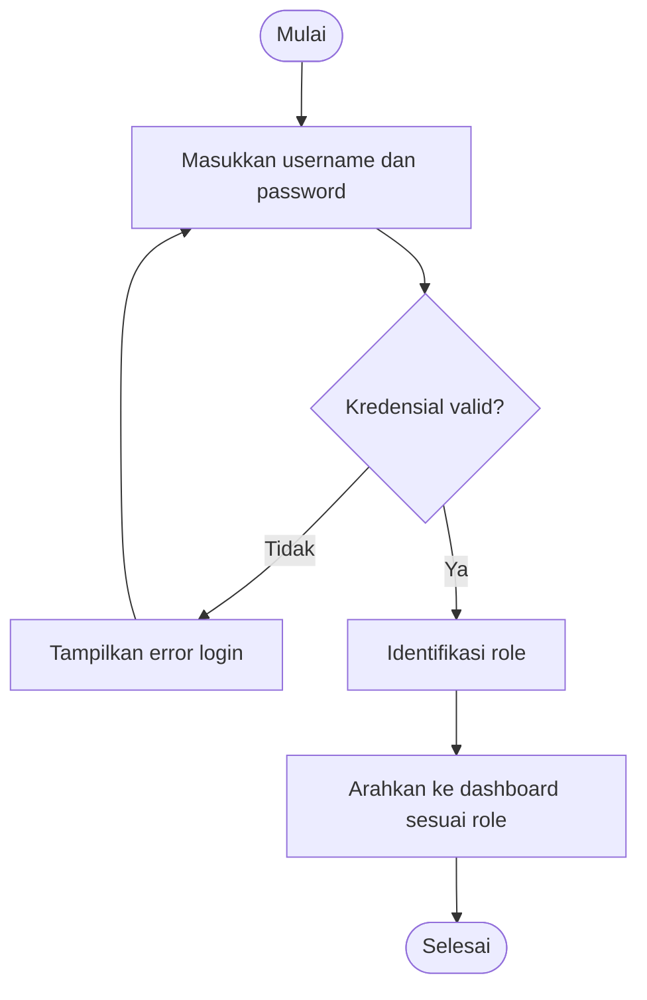
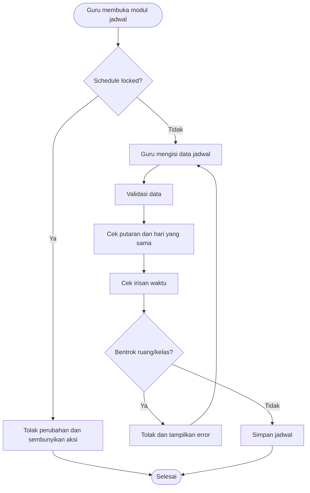
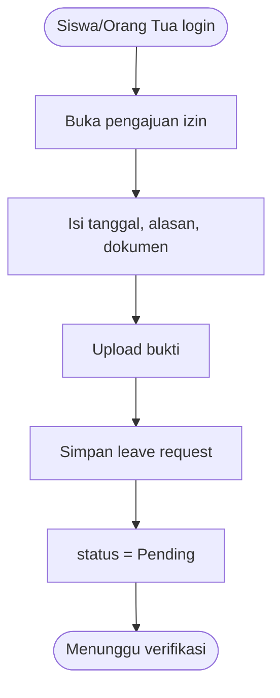
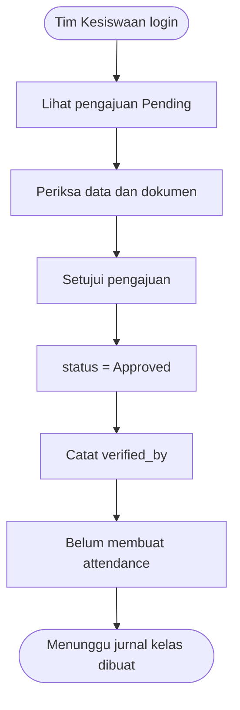
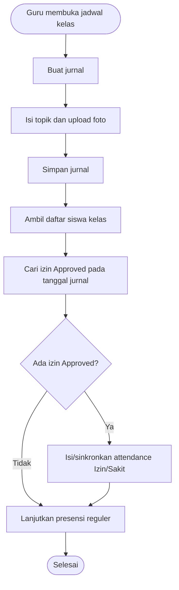
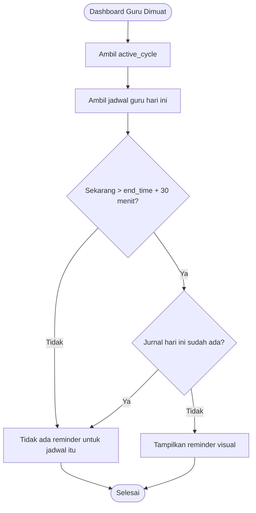

# SOFTWARE REQUIREMENTS SPECIFICATION (SRS)
## School Class Progress (SCP) - Presensi, Jurnal Mengajar, dan Perizinan Siswa

> **Baseline dokumen:** Soal Praktik Kejuruan UKK RPL Tahun Ajaran 2026/2027, Paket 3 RPL-2026.  
> **Judul tugas pada sumber:** *School Class Progress (Presesnis dan Jurnal Sekolah)*.  
> **Status dokumen ini:** Rancangan SRS yang diturunkan dari dokumen UKK. Seluruh kebutuhan wajib di bawah mengacu pada isi PDF. Bagian yang belum ditentukan oleh PDF ditandai secara eksplisit agar tidak dianggap sebagai ketentuan tambahan.

---

# 1. Identitas Dokumen

| Item | Keterangan |
|---|---|
| Nama Sistem | School Class Progress (SCP) |
| Jenis Dokumen | Software Requirements Specification (SRS) |
| Kompetensi Keahlian | Rekayasa Perangkat Lunak |
| Kode Kompetensi | Paket 3 RPL-2026 |
| Tahun Ajaran | 2026/2027 |
| Bentuk Penilaian | Penugasan Perorangan |
| Alokasi Waktu | 16-24 jam |
| Target Utama | Aplikasi pengelolaan presensi, jurnal mengajar guru, perizinan siswa, jadwal blok, dan monitoring keterlambatan jurnal |
| Pendekatan Antarmuka | Mobile-First Design |

---

# 2. Tujuan Dokumen

Dokumen SRS ini bertujuan menerjemahkan soal UKK SCP menjadi spesifikasi perangkat lunak yang lebih terstruktur, rinci, mudah dipahami, dan dapat dijadikan acuan selama analisis, perancangan, implementasi, pengujian, serta presentasi UKK.

Dokumen ini berfungsi sebagai:

1. Acuan fitur yang wajib tersedia.
2. Acuan hak akses setiap pengguna.
3. Acuan aturan bisnis inti yang menentukan valid/tidaknya aplikasi.
4. Acuan struktur data dan relasi database.
5. Acuan alur kerja sistem.
6. Acuan validasi dan skenario pengujian.
7. Acuan pengecekan kesesuaian aplikasi dengan rubrik penilaian UKK.

---

# 3. Ruang Lingkup Sistem

School Class Progress (SCP) adalah platform sekolah untuk mendukung pembelajaran berbasis **Teaching Factory** dengan **siklus jadwal blok dua mingguan**.

Sistem wajib mencakup kebutuhan berikut:

- autentikasi pengguna;
- pengelolaan profil;
- pengelolaan master data oleh Waka Kurikulum;
- pengaturan Putaran 1 dan Putaran 2;
- input jadwal mengajar oleh guru;
- pencegahan jadwal bentrok berdasarkan waktu, ruang, dan kelas;
- mekanisme penguncian jadwal;
- pengisian jurnal mengajar;
- pengisian presensi siswa;
- unggah bukti foto jurnal secara real-time;
- pengajuan izin/sakit oleh siswa atau orang tua;
- unggah dokumen pendukung izin;
- verifikasi pengajuan izin oleh Tim Kesiswaan;
- sinkronisasi izin yang disetujui ke presensi saat guru membuka jurnal kelas;
- rekap kehadiran siswa;
- dashboard reminder apabila guru terlambat mengisi jurnal lebih dari 30 menit setelah jadwal selesai.

Sistem dirancang **Mobile-First** agar nyaman digunakan guru saat berada di kelas dan orang tua saat mengakses dari rumah.

---

# 4. Sumber Kebutuhan dan Prinsip Kepatuhan

Spesifikasi ini diturunkan dari lima kelompok informasi pada PDF UKK:

1. Petunjuk umum pengerjaan.
2. Hak akses pengguna dan matriks fitur.
3. Lima aturan bisnis inti.
4. Blueprint skema basis data.
5. Instrumen dan indikator penilaian.

## 4.1 Prinsip yang wajib dipatuhi

- Logika backend harus benar, bukan hanya tampilan.
- Validasi bentrok jadwal wajib aktif.
- Alur perizinan dan sinkronisasi presensi wajib konsisten.
- Siklus blok Putaran 1/2 wajib memengaruhi tampilan operasional secara global.
- Jadwal yang sudah dikunci tidak boleh dimodifikasi guru, termasuk melalui API.
- Struktur proyek harus rapi dan mengikuti konsep Clean Code serta Standard Directory Structure.
- Repositori kode harus disimpan/di-commit berkala dengan pesan yang deskriptif.

---

# 5. Definisi dan Istilah

| Istilah | Definisi |
|---|---|
| SCP | School Class Progress |
| Teaching Factory | Pola pembelajaran yang menjadi konteks penggunaan jadwal blok pada sistem |
| Putaran 1 | Salah satu siklus jadwal blok aktif |
| Putaran 2 | Siklus jadwal blok alternatif terhadap Putaran 1 |
| Active Cycle | Putaran yang sedang berlaku secara global pada sistem |
| Lock Schedule | Kondisi saat Waka Kurikulum mengunci jadwal sehingga guru tidak dapat menambah, mengubah, atau menghapus jadwal |
| Conflict Prevention | Mekanisme otomatis untuk menolak jadwal yang waktunya beririsan pada ruang atau kelas yang sama |
| Jurnal | Catatan pelaksanaan kegiatan mengajar guru berdasarkan suatu jadwal |
| Presensi | Catatan status kehadiran siswa pada jurnal/kelas tertentu |
| Leave Request | Pengajuan izin atau sakit dari siswa/orang tua |
| Applicant | Pengguna yang melakukan pengajuan izin; dapat berupa siswa atau orang tua |
| Verified By | Pengguna dari Tim Kesiswaan yang memverifikasi pengajuan izin |
| Reminder Jurnal | Peringatan visual bila jadwal guru telah berakhir lebih dari 30 menit tetapi jurnal belum dibuat |
| Mobile-First | Pendekatan desain yang memprioritaskan pengalaman pada layar ponsel, lalu disesuaikan untuk layar lebih besar |

---

# 6. Gambaran Umum Produk

## 6.1 Konteks penggunaan

SCP digunakan oleh pihak sekolah dan keluarga siswa untuk memusatkan proses jadwal, jurnal pembelajaran, presensi, serta perizinan. Sistem tidak hanya menyimpan data, tetapi juga wajib menjalankan logika otomatis yang menghubungkan jadwal, jurnal, izin, dan presensi.

## 6.2 Sasaran utama

1. Mencegah tabrakan jadwal guru/kelas/ruang.
2. Memastikan aktivitas mengajar memiliki jurnal dan presensi.
3. Memudahkan izin/sakit diajukan secara terdokumentasi.
4. Menjaga sinkronisasi izin yang sudah disetujui dengan presensi kelas.
5. Memudahkan Waka mengendalikan siklus blok dan masa pengisian jadwal.
6. Memberikan peringatan kepada guru yang belum membuat jurnal sesuai jadwal.

---

# 7. Aktor dan Role Pengguna

PDF menyebut terdapat **6 role**, tetapi antarmuka disederhanakan menjadi **4 kelompok UI utama**.

## 7.1 Daftar role

1. Waka Kurikulum.
2. Guru.
3. Wali Kelas.
4. Guru BK.
5. Siswa.
6. Orang Tua.

## 7.2 Kelompok antarmuka

### A. Waka Kurikulum

Tanggung jawab:

- mengelola master data;
- menentukan siklus blok aktif;
- melakukan Lock Schedule;
- menerima notifikasi/rekap guru yang belum mengisi jurnal.

### B. Guru

Tanggung jawab:

- menginput rencana jadwal mengajar secara mandiri sesuai SK;
- mengisi jurnal mengajar;
- mengisi presensi siswa;
- mengunggah bukti foto kegiatan secara real-time;
- menerima peringatan keterlambatan jurnal pada dashboard.

### C. Tim Kesiswaan

Terdiri dari:

- Wali Kelas;
- Guru BK.

Keduanya menggunakan antarmuka yang serupa.

Tanggung jawab:

- memantau rekap absensi;
- memeriksa pengajuan izin/sakit;
- melakukan verifikasi/persetujuan sesuai kelas perwalian.

### D. Siswa dan Orang Tua

Menggunakan portal login yang sama.

Tanggung jawab:

- melihat rekap kehadiran;
- mengajukan izin/sakit;
- mengunggah bukti surat dokter atau dokumen resmi.

---

# 8. Matriks Hak Akses Fitur

| Fitur | Siswa / Orang Tua | Guru | Wali Kelas / Guru BK | Waka Kurikulum |
|---|:---:|:---:|:---:|:---:|
| Login | Ya | Ya | Ya | Ya |
| Logout | Ya | Ya | Ya | Ya |
| Update Profil | Ya | Ya | Ya | Ya |
| Input Jadwal | Tidak | Ya | Tidak | Tidak |
| Cek Tabrakan Waktu/Ruang/Kelas | Tidak | Otomatis saat input jadwal | Tidak | Tidak |
| Input Jurnal | Tidak | Ya | Tidak | Tidak |
| Input Presensi | Tidak | Ya | Tidak | Tidak |
| Upload Foto Jurnal | Tidak | Ya | Tidak | Tidak |
| Pengajuan Izin/Sakit | Ya | Tidak | Tidak | Tidak |
| Upload Dokumen Izin | Ya | Tidak | Tidak | Tidak |
| Verifikasi/Approve Izin | Tidak | Tidak | Ya | Tidak |
| Lihat Rekap Absensi | Ya | Sesuai kebutuhan operasional | Ya | Tidak disebut eksplisit pada matriks |
| Dashboard Reminder Jurnal >30 menit | Tidak | Ya | Tidak | Menerima rekap/notifikasi guru belum jurnal |
| Lock Schedule | Tidak | Tidak | Tidak | Ya |
| Toggle Putaran 1/2 | Tidak | Tidak | Tidak | Ya |
| Kelola Master Data | Tidak | Tidak | Tidak | Ya |

> Catatan: Dokumen sumber menyebut Waka mengelola master data, tetapi tidak merinci daftar seluruh operasi CRUD maupun halaman master data. Implementasi harus tetap mengacu pada entitas blueprint database yang relevan.

---

# 9. Kebutuhan Fungsional

Setiap kebutuhan diberi ID agar mudah dilacak saat coding dan testing.

## 9.1 Autentikasi dan Profil

### FR-AUTH-001 - Login

Sistem harus menyediakan proses login untuk seluruh role.

**Aktor:** seluruh pengguna.  
**Hasil:** pengguna yang valid masuk ke sistem dan memperoleh akses sesuai role.

### FR-AUTH-002 - Role-Based Access Control

Setelah login, sistem harus membatasi halaman, aksi, dan endpoint berdasarkan role pengguna.

### FR-AUTH-003 - Logout

Sistem harus menyediakan logout bagi seluruh pengguna.

### FR-AUTH-004 - Update Profil

Sistem harus menyediakan fasilitas update profil bagi seluruh role.

**Catatan:** PDF tidak menentukan daftar field profil yang boleh diubah. Field harus disesuaikan dengan data pengguna yang tersedia dan kebutuhan implementasi tanpa menambah aturan bisnis baru.

---

# 10. Kebutuhan Fungsional Waka Kurikulum

## FR-WAKA-001 - Mengelola Master Data

Waka Kurikulum harus dapat mengelola data dasar yang diperlukan sistem.

Blueprint database menunjukkan master data berikut:

- roles;
- classes;
- rooms;
- users;
- konfigurasi sistem.

PDF tidak merinci operasi per tabel. Minimal implementasi harus memastikan data yang diperlukan jadwal, pengguna, kelas, ruang, dan konfigurasi dapat tersedia dengan benar.

## FR-WAKA-002 - Menentukan Active Cycle

Waka Kurikulum harus dapat mengubah siklus global menjadi:

- Putaran 1; atau
- Putaran 2.

Perubahan ini harus tersimpan dalam `system_configurations.active_cycle`.

## FR-WAKA-003 - Dampak Global Active Cycle

Setelah active cycle berubah:

- dashboard operasional guru harus mengikuti putaran aktif;
- pencarian/penampilan jadwal harus mengikuti putaran aktif;
- data jadwal dari putaran yang tidak aktif tidak boleh diperlakukan sebagai jadwal operasional minggu berjalan.

## FR-WAKA-004 - Lock Schedule

Waka Kurikulum harus memiliki aksi untuk mengunci jadwal.

Status disimpan pada `system_configurations.is_schedule_locked`.

## FR-WAKA-005 - Efek Lock pada Guru

Saat jadwal dikunci, guru harus kehilangan hak untuk:

- menambah jadwal;
- mengedit jadwal;
- menghapus jadwal.

Pembatasan wajib diterapkan pada:

1. antarmuka: tombol aksi tidak tersedia/disembunyikan;
2. backend/API: request manipulasi jadwal ditolak.

## FR-WAKA-006 - Rekap Guru Belum Mengisi Jurnal

Waka Kurikulum harus dapat menerima notifikasi atau rekap guru yang belum mengisi jurnal sesuai kondisi keterlambatan yang ditentukan sistem.

---

# 11. Kebutuhan Fungsional Guru - Jadwal

## FR-SCH-001 - Input Jadwal Mengajar

Guru harus dapat memasukkan rencana jadwal mengajar miliknya secara mandiri sesuai SK selama jadwal belum dikunci.

Data jadwal minimal mengikuti blueprint:

- teacher_id;
- class_id;
- room_id;
- subject;
- day_of_week;
- start_time;
- end_time;
- cycle_type.

## FR-SCH-002 - Jadwal Terikat Putaran

Setiap jadwal harus memiliki `cycle_type` agar dapat dibedakan antara Putaran 1 dan Putaran 2.

## FR-SCH-003 - Validasi Konflik

Sebelum jadwal disimpan, sistem wajib mengecek jadwal lain pada:

- putaran yang sama;
- hari yang sama;
- rentang waktu yang beririsan.

Jika ditemukan bentrok pada kelas atau ruang sebagaimana ditentukan soal, jadwal harus ditolak.

Dokumen juga menyebut deteksi irisan waktu/ruang/kelas dengan jadwal guru lain; karena itu implementasi harus memastikan tidak tercipta bentrok penggunaan sumber daya jadwal.

## FR-SCH-004 - Pesan Error Konflik

Jika jadwal bentrok, sistem harus menolak penyimpanan dan menampilkan error yang dapat dipahami pengguna.

## FR-SCH-005 - Pembatasan Setelah Lock

Saat `is_schedule_locked = true`, seluruh operasi create/update/delete jadwal oleh guru harus ditolak.

---

# 12. Algoritma Wajib Conflict Prevention

PDF memberikan rumus utama:

```text
Start_A < End_B AND End_A > Start_B
```

Artinya, jadwal A dianggap memiliki irisan waktu dengan jadwal B jika:

- waktu mulai A lebih kecil daripada waktu selesai B; dan
- waktu selesai A lebih besar daripada waktu mulai B.

## 12.1 Alur pemeriksaan

```text
INPUT jadwal baru
    teacher_id
    class_id
    room_id
    day_of_week
    start_time
    end_time
    cycle_type

CARI jadwal yang:
    cycle_type sama
    AND day_of_week sama
    AND start_time_lama < end_time_baru
    AND end_time_lama > start_time_baru
    AND memiliki konflik ruang/kelas sesuai aturan

JIKA ditemukan konflik
    TOLAK penyimpanan
    TAMPILKAN error
JIKA tidak
    SIMPAN jadwal
```

## 12.2 Contoh rentang

### Contoh bentrok

```text
Jadwal lama : 08:00 - 10:00
Jadwal baru : 09:00 - 11:00

09:00 < 10:00 = benar
11:00 > 08:00 = benar
=> bentrok
```

### Contoh tidak bentrok

```text
Jadwal lama : 08:00 - 10:00
Jadwal baru : 10:00 - 12:00

10:00 < 10:00 = salah
=> tidak bentrok berdasarkan rumus PDF
```

## 12.3 Ketentuan penting

Pengecekan konflik tidak boleh hanya dilakukan di frontend. Backend harus melakukan validasi sebelum menyimpan data agar konflik tidak dapat dilewati menggunakan request langsung/API.

---

# 13. Kebutuhan Fungsional Guru - Jurnal dan Presensi

## FR-JRN-001 - Membuat Jurnal Berdasarkan Jadwal

Guru harus dapat membuat jurnal untuk jadwal mengajar.

Jurnal terhubung dengan `schedule_id`.

## FR-JRN-002 - Data Jurnal

Sesuai blueprint, jurnal menyimpan:

- schedule_id;
- date;
- topic_description;
- photo_path;
- created_at.

## FR-JRN-003 - Upload Foto Real-Time

Saat mengisi jurnal/presensi, guru harus menyediakan bukti foto kegiatan secara real-time.

File disimpan melalui referensi `photo_path` pada tabel `journals`.

## FR-JRN-004 - Validasi Upload Foto

Sistem harus memvalidasi:

- ekstensi/jenis file;
- batas ukuran file.

**Penting:** PDF mewajibkan validasi ekstensi dan ukuran, tetapi tidak menetapkan ekstensi apa saja dan berapa batas maksimal ukuran. Nilainya harus ditentukan oleh implementasi/proyek dan didokumentasikan, tetapi tidak boleh diklaim sebagai nilai yang berasal dari PDF.

## FR-ATT-001 - Membuat Presensi

Guru harus dapat mengisi presensi siswa untuk jurnal/kelas yang sedang dibuka.

## FR-ATT-002 - Relasi Presensi ke Jurnal

Setiap data presensi harus berelasi dengan:

- `journal_id`;
- `student_id`.

## FR-ATT-003 - Tanggal Presensi

Presensi harus menyimpan tanggal pada field `date`.

## FR-ATT-004 - Status Presensi

Presensi harus menyimpan nilai pada field `status` bertipe enum.

Nilai yang secara eksplisit disebut PDF untuk sinkronisasi izin adalah:

- Izin;
- Sakit.

PDF tidak mendefinisikan seluruh daftar status presensi lainnya.

---

# 14. Kebutuhan Fungsional Siswa dan Orang Tua

## FR-STD-001 - Portal Login Bersama

Siswa dan Orang Tua menggunakan portal login yang sama.

Hak akses tetap dibedakan sesuai role setelah autentikasi.

## FR-STD-002 - Melihat Rekap Kehadiran

Siswa/Orang Tua harus dapat melihat rekap kehadiran siswa yang terkait.

## FR-STD-003 - Pengajuan Izin/Sakit

Siswa atau Orang Tua harus dapat membuat pengajuan izin/sakit.

## FR-STD-004 - Data Pengajuan

Sesuai blueprint, pengajuan izin menyimpan:

- student_id;
- applicant_id;
- verified_by;
- start_date;
- end_date;
- reason;
- document_path;
- status_approval.

## FR-STD-005 - Applicant

`applicant_id` digunakan untuk menyimpan pengguna yang benar-benar mengajukan permohonan.

Dengan demikian sistem dapat membedakan apakah pengajuan dilakukan oleh siswa atau orang tua.

## FR-STD-006 - Upload Dokumen

Pengajuan izin harus dilengkapi fitur upload dokumen, misalnya surat dokter atau surat resmi sesuai kasus.

## FR-STD-007 - Status Awal

Setiap pengajuan baru harus berstatus:

```text
Pending
```

## FR-STD-008 - Validasi Dokumen

Rubrik mengharuskan validasi upload file. PDF tidak menentukan nilai ekstensi maupun ukuran maksimum, sehingga parameter tersebut harus ditetapkan pada implementasi dan dicatat sebagai konfigurasi/keputusan teknis.

---

# 15. Kebutuhan Fungsional Tim Kesiswaan

## FR-KES-001 - Melihat Rekap Absensi

Wali Kelas dan Guru BK harus dapat memantau rekap absensi.

## FR-KES-002 - Melihat Pengajuan Izin

Tim Kesiswaan harus dapat melihat pengajuan izin/sakit yang perlu diverifikasi sesuai konteks kelas perwaliannya.

## FR-KES-003 - Approve Izin

Tim Kesiswaan harus dapat mengubah pengajuan dari status `Pending` menjadi `Approved`.

## FR-KES-004 - Mencatat Verifikator

Saat pengajuan diverifikasi, sistem harus dapat mencatat pengguna yang melakukan verifikasi pada `verified_by`.

## FR-KES-005 - Approval Tidak Langsung Membuat Presensi

Ketika izin disetujui, sistem **tidak boleh langsung** membuat presensi pada tabel `attendances`.

Presensi baru disinkronkan pada saat guru mata pelajaran membuat jurnal dan membuka kelas pada hari yang sesuai.

Ini merupakan aturan bisnis inti.

---

# 16. Alur Sinkronisasi Perizinan ke Presensi

## 16.1 Tahap 1 - Pengajuan

```text
Siswa / Orang Tua
    -> mengisi pengajuan izin/sakit
    -> upload dokumen
    -> sistem menyimpan leave_request
    -> status_approval = Pending
```

## 16.2 Tahap 2 - Verifikasi

```text
Tim Kesiswaan
    -> membuka daftar pengajuan
    -> memeriksa data dan dokumen
    -> menyetujui
    -> status_approval = Approved
    -> verified_by diisi
```

## 16.3 Tahap 3 - Menunggu kelas dibuka

Setelah Approved:

- data persetujuan sudah tersimpan;
- tetapi record presensi belum otomatis dibuat saat itu juga.

## 16.4 Tahap 4 - Guru membuat jurnal

Saat guru membuat jurnal dan membuka kelas pada hari yang termasuk rentang izin:

1. sistem mengetahui kelas/jadwal yang sedang dibuka;
2. sistem mencari siswa yang memiliki pengajuan `Approved` pada tanggal tersebut;
3. sistem mengisi/menyinkronkan presensi siswa yang bersangkutan pada tabel `attendances`;
4. status presensi diisi sesuai jenis pengajuan sebagai `Izin` atau `Sakit`.

## 16.5 Pseudocode konseptual

```text
WHEN guru membuat jurnal untuk tanggal X:

    ambil seluruh siswa pada kelas jadwal

    FOR setiap siswa:
        cari leave_request
        WHERE student_id = siswa
          AND status_approval = Approved
          AND start_date <= X
          AND end_date >= X

        IF izin ditemukan:
            sinkronkan attendance untuk journal tersebut
            status = Izin/Sakit sesuai pengajuan
```

> PDF tidak menjelaskan cara membedakan nilai `Izin` dan `Sakit` dalam kolom `reason` atau field lain. Implementasi harus memiliki cara yang konsisten untuk menghasilkan status tersebut, tetapi mekanismenya perlu didokumentasikan sebagai keputusan implementasi karena blueprint tidak menampilkan field khusus `leave_type`.

---

# 17. Kebutuhan Dashboard Reminder Jurnal

## FR-ALT-001 - Pemindaian Saat Dashboard Dimuat

Saat dashboard guru dimuat, sistem harus memindai jadwal guru pada hari tersebut.

## FR-ALT-002 - Kriteria Terlambat

Sebuah jadwal dianggap memerlukan reminder apabila:

1. jadwal adalah jadwal guru yang sedang login;
2. jadwal berlaku pada hari dan putaran aktif;
3. waktu sekarang telah melewati `end_time` lebih dari 30 menit;
4. belum ada jurnal yang sesuai untuk jadwal tersebut pada tanggal hari ini.

## FR-ALT-003 - Peringatan Visual

Jika kondisi tersebut terpenuhi, sistem harus menampilkan indikator/peringatan visual pada dashboard guru.

## FR-ALT-004 - Tanpa Cron Job

Reminder **tidak menggunakan Cron Job**.

Pemeriksaan dilakukan ketika halaman dashboard dimuat.

## FR-ALT-005 - Informasi untuk Waka

Waka Kurikulum harus dapat menerima notifikasi atau rekap guru yang belum mengisi jurnal.

## 17.1 Pseudocode konseptual

```text
ON dashboard guru dibuka:

    active_cycle = konfigurasi.active_cycle
    today = hari sekarang
    now = waktu sekarang

    ambil jadwal guru
    WHERE cycle_type = active_cycle
      AND day_of_week = today

    FOR setiap jadwal:
        deadline = end_time + 30 menit

        IF now > deadline:
            cari journal untuk schedule_id dan tanggal hari ini

            IF journal tidak ditemukan:
                tampilkan reminder visual
```

---

# 18. Sistem Blok dan Pergantian Putaran

## FR-CYC-001 - Satu Active Cycle Global

Sistem harus mempunyai konfigurasi global untuk menunjukkan putaran yang sedang aktif.

Blueprint menyediakan:

```text
system_configurations.active_cycle
```

## FR-CYC-002 - Otoritas Perubahan

Hanya Waka Kurikulum yang memiliki fungsi untuk mengganti putaran aktif.

## FR-CYC-003 - Nilai Putaran

Nilai operasional yang disebut pada PDF:

- Putaran 1;
- Putaran 2.

## FR-CYC-004 - Dampak Perubahan

Perubahan active cycle harus membuat sistem menyesuaikan secara global, terutama:

- dashboard guru;
- pencarian/daftar jadwal;
- jadwal operasional yang digunakan untuk jurnal dan reminder.

---

# 19. Mekanisme Lock Schedule

## FR-LOCK-001 - Status Global Lock

Blueprint menyediakan:

```text
system_configurations.is_schedule_locked
```

Nilai ini harus menjadi sumber status penguncian jadwal.

## FR-LOCK-002 - UI Protection

Saat locked:

- tombol tambah jadwal tidak tersedia;
- tombol edit jadwal tidak tersedia;
- tombol hapus jadwal tidak tersedia.

## FR-LOCK-003 - API/Backend Protection

Backend harus selalu memeriksa status lock sebelum melakukan create/update/delete jadwal.

Jika locked, request harus ditolak walaupun dikirim tanpa melalui UI.

## FR-LOCK-004 - Audit Pengubah Konfigurasi

Blueprint menyediakan `updated_by` pada `system_configurations` yang berelasi ke pengguna. Field ini dapat digunakan untuk mencatat pengguna yang terakhir memperbarui konfigurasi sistem.

---

# 20. Rancangan Database Wajib

Struktur database harus mengacu pada blueprint PDF karena digunakan untuk mendukung Conflict Prevention dan Sinkronisasi Izin.

Terdapat 9 tabel utama:

1. roles;
2. classes;
3. rooms;
4. users;
5. system_configurations;
6. schedules;
7. journals;
8. attendances;
9. leave_requests.

---

# 21. Data Dictionary

## 21.1 Tabel `roles`

| Field | Tipe pada Blueprint | Null | Keterangan |
|---|---|---|---|
| id | int | Tidak ditandai NN pada PK | Primary key |
| role_name | varchar(50) | NN | Nama role pengguna |

Fungsi: menyimpan daftar role pengguna.

Relasi utama:

```text
roles.id -> users.role_id
```

---

## 21.2 Tabel `classes`

| Field | Tipe pada Blueprint | Null | Keterangan |
|---|---|---|---|
| id | int | PK | Primary key |
| class_name | varchar(50) | NN | Nama kelas |

Relasi:

```text
classes.id -> users.class_id
classes.id -> schedules.class_id
```

---

## 21.3 Tabel `rooms`

| Field | Tipe pada Blueprint | Null | Keterangan |
|---|---|---|---|
| id | int | PK | Primary key |
| room_name | varchar(50) | NN | Nama ruang |

Relasi:

```text
rooms.id -> schedules.room_id
```

---

## 21.4 Tabel `users`

| Field | Tipe pada Blueprint | Null | Keterangan |
|---|---|---|---|
| id | int | PK | Primary key |
| role_id | int | NN | Foreign key ke roles |
| parent_id | int | Tidak ditandai NN | Relasi pengguna siswa dengan akun orang tua/pengguna terkait |
| class_id | int | Tidak ditandai NN | Foreign key ke classes, terutama relevan untuk siswa |
| username | varchar(50) | NN | Username login |
| password | varchar(255) | NN | Password pengguna |
| fullname | varchar(100) | NN | Nama lengkap |
| created_at | timestamp | Tidak ditandai NN | Waktu data dibuat |

Relasi yang terlihat pada blueprint:

```text
users.role_id -> roles.id
users.class_id -> classes.id
users.parent_id -> users.id     (self relation)
```

Pengguna juga direferensikan oleh beberapa tabel lain:

```text
schedules.teacher_id -> users.id
leave_requests.student_id -> users.id
leave_requests.applicant_id -> users.id
leave_requests.verified_by -> users.id
attendances.student_id -> users.id
system_configurations.updated_by -> users.id
```

---

## 21.5 Tabel `system_configurations`

| Field | Tipe pada Blueprint | Null | Keterangan |
|---|---|---|---|
| id | int | PK | Primary key |
| active_cycle | enum | NN | Putaran aktif sistem |
| is_schedule_locked | boolean | NN | Status kunci jadwal |
| updated_by | int | NN | Pengguna yang memperbarui konfigurasi |

Nilai bisnis utama:

```text
active_cycle = Putaran 1 / Putaran 2
is_schedule_locked = true / false
```

---

## 21.6 Tabel `schedules`

| Field | Tipe pada Blueprint | Null | Keterangan |
|---|---|---|---|
| id | int | PK | Primary key |
| teacher_id | int | NN | Guru pemilik jadwal |
| class_id | int | NN | Kelas yang diajar |
| room_id | int | NN | Ruang yang digunakan |
| subject | varchar(100) | NN | Mata pelajaran |
| day_of_week | enum | NN | Hari pelaksanaan |
| start_time | time | NN | Jam mulai |
| end_time | time | NN | Jam selesai |
| cycle_type | enum | NN | Putaran jadwal |

Relasi:

```text
schedules.teacher_id -> users.id
schedules.class_id   -> classes.id
schedules.room_id    -> rooms.id
schedules.id         -> journals.schedule_id
```

Kegunaan utama:

- sumber jadwal operasional;
- sumber Conflict Prevention;
- sumber reminder jurnal;
- penghubung guru, kelas, ruang, hari, waktu, dan siklus.

---

## 21.7 Tabel `journals`

| Field | Tipe pada Blueprint | Null | Keterangan |
|---|---|---|---|
| id | int | PK | Primary key |
| schedule_id | int | NN | Foreign key ke schedule |
| date | date | NN | Tanggal jurnal |
| topic_description | text | NN | Deskripsi/topik pembelajaran |
| photo_path | varchar(255) | NN | Lokasi/path bukti foto |
| created_at | timestamp | Tidak ditandai NN | Waktu jurnal dibuat |

Relasi:

```text
journals.schedule_id -> schedules.id
journals.id -> attendances.journal_id
```

---

## 21.8 Tabel `attendances`

| Field | Tipe pada Blueprint | Null | Keterangan |
|---|---|---|---|
| id | int | PK | Primary key |
| journal_id | int | NN | Jurnal tempat presensi dibuat |
| student_id | int | NN | Siswa yang dipresensi |
| status | enum | NN | Status kehadiran |
| date | date | NN | Tanggal presensi |

Relasi:

```text
attendances.journal_id -> journals.id
attendances.student_id -> users.id
```

Nilai status yang eksplisit disebut dalam aturan sinkronisasi:

```text
Izin
Sakit
```

Daftar enum lengkap tidak diberikan PDF.

---

## 21.9 Tabel `leave_requests`

| Field | Tipe pada Blueprint | Null | Keterangan |
|---|---|---|---|
| id | int | PK | Primary key |
| student_id | int | NN | Siswa yang mengajukan/mendapat izin |
| applicant_id | int | NN | Pengguna yang membuat pengajuan |
| verified_by | int | Tidak ditandai NN | Tim Kesiswaan yang memverifikasi |
| start_date | date | NN | Awal masa izin |
| end_date | date | NN | Akhir masa izin |
| reason | text | NN | Alasan izin/sakit |
| document_path | varchar(255) | NN | Lokasi dokumen bukti |
| status_approval | enum | NN | Status persetujuan |

Relasi:

```text
leave_requests.student_id  -> users.id
leave_requests.applicant_id -> users.id
leave_requests.verified_by  -> users.id
```

Nilai status yang secara eksplisit disebut:

```text
Pending
Approved
```

PDF tidak menyebut nilai status lain seperti Rejected, sehingga nilai tersebut tidak dinyatakan wajib dalam SRS ini.

---

# 22. ERD Konseptual dalam Mermaid

Diagram berikut merupakan representasi tekstual dari blueprint database pada PDF.



---

# 23. Relasi Bisnis Antar Entitas

## 23.1 Role ke User

Satu role dapat dimiliki banyak user.

```text
roles 1 --- N users
```

## 23.2 Class ke User

Satu kelas dapat memiliki banyak siswa/pengguna yang relevan.

```text
classes 1 --- N users
```

## 23.3 User Parent Relation

Blueprint menyediakan `parent_id` pada users sebagai relasi diri sendiri.

```text
users(parent) 1 --- N users(student)
```

## 23.4 Guru ke Schedule

Satu guru dapat memiliki banyak jadwal.

```text
users(teacher) 1 --- N schedules
```

## 23.5 Kelas ke Schedule

Satu kelas dapat memiliki banyak jadwal.

```text
classes 1 --- N schedules
```

## 23.6 Ruang ke Schedule

Satu ruang dapat digunakan pada banyak jadwal yang berbeda selama tidak bentrok.

```text
rooms 1 --- N schedules
```

## 23.7 Schedule ke Journal

Satu schedule dapat menghasilkan jurnal pada tanggal pelaksanaan yang berbeda.

```text
schedules 1 --- N journals
```

## 23.8 Journal ke Attendance

Satu jurnal memiliki banyak record presensi siswa.

```text
journals 1 --- N attendances
```

## 23.9 Student ke Attendance

Satu siswa dapat mempunyai banyak record presensi.

```text
users(student) 1 --- N attendances
```

## 23.10 Leave Request ke User

Satu leave request memiliki tiga kemungkinan referensi pengguna:

- siswa yang diizinkan (`student_id`);
- pengguna yang mengajukan (`applicant_id`);
- pengguna yang memverifikasi (`verified_by`).

---

# 24. Alur Sistem Utama

## 24.1 Alur Login



---

## 24.2 Alur Input Jadwal Guru



---

## 24.3 Alur Pengajuan Izin



---

## 24.4 Alur Verifikasi Izin



---

## 24.5 Alur Jurnal dan Sinkronisasi Izin



---

## 24.6 Alur Reminder Jurnal



---

# 25. Spesifikasi Validasi

## VAL-001 - Authentication

Request yang memerlukan login tidak boleh diproses tanpa pengguna terautentikasi.

## VAL-002 - Authorization

Pengguna tidak boleh menjalankan aksi di luar role-nya.

## VAL-003 - Schedule Lock

Setiap create/update/delete jadwal wajib memeriksa `is_schedule_locked`.

## VAL-004 - Schedule Conflict

Jadwal baru/update wajib melalui query overlap.

## VAL-005 - Cycle Consistency

Dashboard dan pencarian jadwal operasional harus menggunakan `active_cycle`.

## VAL-006 - Journal Photo

Foto jurnal wajib melewati validasi ekstensi dan ukuran.

## VAL-007 - Leave Document

Dokumen izin wajib melewati validasi file sesuai aturan implementasi.

## VAL-008 - Leave Approval

Pengajuan baru harus dimulai dari `Pending`; sinkronisasi presensi hanya berlaku setelah `Approved`.

## VAL-009 - Attendance Sync Timing

Approved leave tidak langsung membuat attendance; sinkronisasi terjadi ketika jurnal/kelas hari terkait dibuka.

## VAL-010 - Reminder

Reminder hanya muncul apabila jadwal selesai lebih dari 30 menit dan jurnal belum ada.

---

# 26. Kebutuhan Antarmuka / UI-UX

## UI-001 - Mobile-First

Tampilan harus dirancang mulai dari kebutuhan layar ponsel.

Prioritas:

- navigasi sederhana;
- form mudah digunakan dengan sentuhan;
- tombol aksi jelas;
- tabel/rekap tetap terbaca pada layar kecil;
- upload foto/dokumen mudah dilakukan dari perangkat bergerak;
- reminder visual mudah terlihat.

## UI-002 - Empat Kelompok Antarmuka

Sistem boleh berbagi layout antarrole sesuai penyederhanaan soal:

1. Waka Kurikulum;
2. Guru;
3. Wali Kelas/Guru BK;
4. Siswa/Orang Tua.

## UI-003 - Hidden Actions saat Locked

Ketika jadwal dikunci, aksi manipulasi jadwal oleh guru harus disembunyikan dari UI.

## UI-004 - Error Conflict Jelas

Saat jadwal ditolak karena bentrok, sistem harus memberi pesan error yang menjelaskan bahwa jadwal tidak dapat disimpan karena konflik.

## UI-005 - Reminder Visual

Keterlambatan jurnal harus memiliki indikator/peringatan visual pada dashboard.

## UI-006 - Upload Feedback

Saat pengguna mengunggah foto/dokumen, sistem harus memberi feedback sukses/gagal validasi.

---

# 27. Kebutuhan API dan Backend

PDF tidak menentukan framework maupun bentuk URL endpoint, tetapi secara eksplisit menyatakan endpoint API harus dilindungi ketika jadwal dikunci. Karena itu kebutuhan backend minimal adalah:

## API-001

Backend harus menerapkan autentikasi dan otorisasi sesuai role.

## API-002

Endpoint manipulasi jadwal harus mengecek status `is_schedule_locked`.

## API-003

Validasi bentrok harus dilakukan pada backend, bukan bergantung pada JavaScript/UI.

## API-004

Perubahan active cycle harus dibaca oleh modul operasional secara global.

## API-005

Alur approval dan sinkronisasi izin harus dilakukan secara konsisten/transaksional agar data leave request dan attendance tidak berbeda keadaan.

> Struktur URI, metode autentikasi, framework, nama controller, dan format response JSON tidak ditentukan oleh PDF sehingga tidak dinyatakan sebagai ketentuan wajib di SRS ini.

---

# 28. Kebutuhan Non-Fungsional

## NFR-001 - Mobile Usability

Sistem harus optimal digunakan pada perangkat mobile.

## NFR-002 - Data Integrity

Sistem harus mencegah data jadwal bentrok dan menjaga konsistensi relasi izin-jurnal-presensi.

## NFR-003 - Security of Authorization

Pembatasan akses tidak boleh hanya mengandalkan tombol yang disembunyikan; backend harus memverifikasi hak akses.

## NFR-004 - Maintainability

Kode dan struktur folder harus rapi mengikuti Clean Code dan Standard Directory Structure.

## NFR-005 - Traceability Development

Commit Git dilakukan berkala dan menggunakan pesan deskriptif untuk audit trail.

## NFR-006 - File Validation

Foto dan dokumen harus divalidasi berdasarkan ekstensi/jenis file dan ukuran.

## NFR-007 - Responsiveness

Antarmuka harus menyesuaikan ukuran layar karena penggunaan ditujukan untuk guru di kelas dan orang tua di rumah.

## NFR-008 - Environment Compatibility

Soal mengizinkan lingkungan kerja berbasis Windows/Linux dan DBMS MySQL, MariaDB, atau PostgreSQL.

## NFR-009 - Dependency/Package Preparation

Lingkungan pengembangan harus mendukung manajemen dependency dan sinkronisasi package/library.

---

# 29. Perangkat dan Lingkungan Kerja Minimum dari Soal

| Komponen | Spesifikasi Minimal |
|---|---|
| Komputer | CPU Core i3/setara, RAM 4 GB; 8 GB direkomendasikan; storage bebas |
| Sistem Operasi | Windows atau Linux Desktop |
| IDE/Editor | VS Code atau IDE pilihan |
| Local Environment | XAMPP, Laragon, atau Docker environment |
| DBMS | MySQL, MariaDB, atau PostgreSQL |
| Internet | Minimal 2 Mbps untuk sinkronisasi package/library |

---

# 30. Aturan Bisnis Inti / Kunci Kelulusan

Soal menyatakan aplikasi dapat dinyatakan gagal/tidak valid apabila lima logika berikut tidak diimplementasikan.

## BR-001 - Conflict Prevention

Sistem wajib mencegah jadwal beririsan pada putaran/hari yang sama ketika terjadi konflik penggunaan ruang/kelas menurut aturan soal.

Rumus overlap:

```text
Start_A < End_B AND End_A > Start_B
```

## BR-002 - Cycle Toggle

Waka wajib dapat memilih Putaran 1/2 dan seluruh dashboard operasional/pencarian jadwal menyesuaikan secara global.

## BR-003 - Lock Schedule

Setelah jadwal dikunci, guru tidak boleh create/update/delete jadwal melalui UI maupun API.

## BR-004 - Leave Synchronization

Izin berstatus Approved baru disinkronkan ke attendance saat guru membuat jurnal dan membuka kelas pada hari terkait.

## BR-005 - Journal Reminder

Pada load dashboard, jadwal yang berakhir lebih dari 30 menit tanpa journal harus menghasilkan peringatan visual. Tidak menggunakan Cron Job.

---

# 31. State dan Transisi Data Penting

## 31.1 Leave Request

```text
Dibuat
  -> Pending
  -> Approved
  -> menunggu jurnal pada tanggal terkait
  -> tersinkronisasi ke attendance saat kelas dibuka
```

PDF tidak menetapkan state penolakan, pembatalan, atau kedaluwarsa.

## 31.2 Schedule Lock

```text
Unlocked
  -> guru boleh create/update/delete jadwal

Locked
  -> guru tidak boleh create/update/delete jadwal
```

## 31.3 Active Cycle

```text
Putaran 1 <-> Putaran 2
```

Perubahan dilakukan oleh Waka dan berlaku global.

---

# 32. Kriteria Penerimaan Fitur

## AC-001 Login

**Given** pengguna memiliki akun valid  
**When** login dengan kredensial benar  
**Then** pengguna masuk ke dashboard sesuai hak akses.

## AC-002 RBAC

**Given** pengguna bukan Waka  
**When** mencoba menjalankan fungsi Lock Schedule  
**Then** sistem menolak akses.

## AC-003 Input Jadwal Normal

**Given** jadwal belum dikunci dan tidak ada konflik  
**When** guru menyimpan jadwal  
**Then** jadwal tersimpan.

## AC-004 Bentrok Waktu dan Ruang/Kelas

**Given** terdapat jadwal pada putaran, hari, dan waktu beririsan serta konflik ruang/kelas  
**When** guru mencoba menyimpan jadwal baru  
**Then** sistem menolak dan menampilkan error.

## AC-005 Tidak Bentrok pada Batas Waktu

**Given** jadwal A selesai pukul 10:00  
**When** jadwal B mulai pukul 10:00  
**Then** jadwal B tidak dianggap overlap oleh rumus yang diberikan.

## AC-006 Cycle Toggle

**Given** active cycle = Putaran 1  
**When** Waka mengubah menjadi Putaran 2  
**Then** dashboard/pencarian jadwal mengikuti Putaran 2.

## AC-007 Lock UI

**Given** schedule telah locked  
**When** guru membuka modul jadwal  
**Then** tombol tambah/edit/hapus tidak tersedia.

## AC-008 Lock API

**Given** schedule telah locked  
**When** guru mengirim request langsung untuk create/update/delete  
**Then** backend menolak request.

## AC-009 Leave Request Pending

**Given** siswa/orang tua mengajukan izin  
**When** data valid tersimpan  
**Then** status awal = Pending.

## AC-010 Approval

**Given** terdapat izin Pending  
**When** Tim Kesiswaan menyetujui  
**Then** status menjadi Approved dan verifier tercatat.

## AC-011 Approval Tidak Langsung Membuat Attendance

**Given** izin baru saja Approved  
**When** jurnal hari terkait belum dibuat  
**Then** attendance izin/sakit belum disinkronkan.

## AC-012 Sync saat Jurnal Dibuka

**Given** izin Approved mencakup tanggal jurnal  
**When** guru membuat jurnal dan membuka kelas  
**Then** attendance siswa tersinkronisasi sebagai Izin/Sakit.

## AC-013 Jurnal dengan Foto

**Given** guru mengisi jurnal  
**When** foto memenuhi aturan file  
**Then** jurnal tersimpan dengan photo_path.

## AC-014 File Invalid

**Given** file tidak memenuhi validasi ekstensi/ukuran  
**When** upload dilakukan  
**Then** sistem menolak file dan menampilkan error.

## AC-015 Reminder Belum 30 Menit

**Given** jadwal telah selesai tetapi belum lewat 30 menit  
**When** dashboard dimuat  
**Then** reminder keterlambatan belum wajib muncul.

## AC-016 Reminder Lewat 30 Menit

**Given** jadwal selesai lebih dari 30 menit dan jurnal belum ada  
**When** dashboard dimuat  
**Then** reminder visual muncul.

## AC-017 Tidak Reminder Bila Jurnal Sudah Ada

**Given** jadwal selesai lebih dari 30 menit  
**And** jurnal telah dibuat  
**When** dashboard dimuat  
**Then** reminder untuk jadwal tersebut tidak muncul.

## AC-018 Tanpa Cron

**Given** mekanisme reminder diimplementasikan  
**Then** pengecekan dijalankan saat dashboard dimuat, bukan bergantung Cron Job.

---

# 33. Skenario Pengujian Inti

| ID | Skenario | Expected Result |
|---|---|---|
| TC-01 | Login seluruh role | Berhasil dan masuk UI sesuai role |
| TC-02 | Akses fitur role lain | Ditolak |
| TC-03 | Guru tambah jadwal saat unlocked | Berhasil jika valid |
| TC-04 | Jadwal overlap ruang/kelas | Ditolak |
| TC-05 | Jadwal tidak overlap | Diterima |
| TC-06 | Waka toggle Putaran 1 -> 2 | Tampilan operasional mengikuti Putaran 2 |
| TC-07 | Waka lock jadwal | Status lock aktif |
| TC-08 | Guru edit jadwal saat locked dari UI | Aksi tidak tersedia |
| TC-09 | Guru edit jadwal saat locked via API | Backend menolak |
| TC-10 | Guru buat jurnal dengan foto valid | Tersimpan |
| TC-11 | Upload foto tidak valid | Ditolak |
| TC-12 | Siswa membuat izin | Pending |
| TC-13 | Orang tua membuat izin | Pending dengan applicant sesuai akun orang tua |
| TC-14 | Kesiswaan approve izin | Approved + verified_by tercatat |
| TC-15 | Izin Approved sebelum jurnal | Attendance belum tersinkronisasi |
| TC-16 | Guru membuat jurnal di tanggal izin | Attendance menjadi Izin/Sakit |
| TC-17 | Dashboard sebelum +30 menit | Tidak ada reminder terlambat |
| TC-18 | Dashboard lewat +30 menit tanpa jurnal | Reminder muncul |
| TC-19 | Dashboard lewat +30 menit dengan jurnal | Reminder tidak muncul |
| TC-20 | Waka melihat rekap guru belum jurnal | Data keterlambatan tersedia |

---

# 34. Traceability Matrix ke Rubrik UKK

| Rubrik | Implementasi yang Harus Terlihat | Requirement Terkait |
|---|---|---|
| Persiapan local server/database/runtime | Environment berjalan | NFR-008, NFR-009 |
| Struktur folder & dependency/Git | Project rapi, commit berkala | NFR-004, NFR-005 |
| Anti-Tabrakan Waktu | Jadwal bentrok diblokir | BR-001, FR-SCH-003 |
| Lock Schedule | Waka mengunci, guru tidak dapat ubah | BR-003, FR-WAKA-004, FR-WAKA-005 |
| Sinkronisasi Perizinan | Approved disinkronkan ketika jurnal dibuat | BR-004, FR-KES-005 |
| Modul Putaran Blok | Putaran 1/2 mengubah tampilan global | BR-002, FR-CYC-004 |
| Form Jurnal & Photo | Upload + validasi ekstensi/ukuran | FR-JRN-003, FR-JRN-004 |
| Dashboard Alert | Keterlambatan >30 menit terlihat | BR-005, FR-ALT-003 |
| Debugging mandiri | Mampu menyelesaikan error | Praktik pengerjaan |
| Selesai tepat waktu | Seluruh alur selesai dalam waktu UKK | Manajemen pengerjaan |

---

# 35. Prioritas Implementasi Berdasarkan Bobot Penilaian

## Prioritas 1 - Proses & Kualitas Coding (40%)

Wajib dipastikan lebih dahulu:

1. anti-tabrakan waktu/ruang/kelas;
2. Lock Schedule frontend + backend;
3. sinkronisasi izin Approved ke attendance saat jurnal dibuat.

## Prioritas 2 - Hasil Produk / UI-UX (30%)

1. Toggle Putaran 1/2 global;
2. jurnal dan upload foto;
3. validasi ekstensi serta ukuran file;
4. dashboard alert jurnal terlambat.

## Prioritas 3 - Sikap & Waktu (20%)

1. debugging mandiri;
2. penyelesaian tepat waktu.

## Prioritas 4 - Persiapan Kerja (10%)

1. local web server;
2. database;
3. runtime;
4. dependency;
5. struktur folder;
6. repository Git.

---

# 36. Hal yang Tidak Ditentukan Secara Eksplisit oleh PDF

Bagian berikut **tidak boleh dianggap sebagai requirement resmi dari soal** karena PDF tidak memberikan detailnya:

1. Framework backend yang wajib digunakan.
2. Framework frontend yang wajib digunakan.
3. Metode autentikasi API tertentu.
4. Nama endpoint API.
5. Format JSON response.
6. Warna/tema UI.
7. Daftar lengkap nilai enum `day_of_week` secara teknis.
8. Daftar lengkap nilai enum `attendance.status` selain Izin/Sakit yang disebut dalam alur.
9. Status leave request selain Pending dan Approved.
10. Batas maksimal ukuran foto/dokumen.
11. Daftar ekstensi upload yang diizinkan.
12. Mekanisme penolakan pengajuan izin.
13. Fitur reset password.
14. Fitur registrasi akun mandiri.
15. Fitur ekspor PDF/Excel.
16. Fitur email/WhatsApp notification.
17. Cron Job untuk reminder; justru soal secara eksplisit melarang kebutuhan Cron pada mekanisme reminder dashboard.

Jika fitur tambahan dibuat, fitur tersebut sebaiknya tidak mengganggu alur wajib UKK.

---

# 37. Risiko Implementasi yang Harus Dihindari

## RISK-001 - Validasi Konflik Hanya di UI

Dampak: jadwal bentrok masih bisa disimpan melalui API.  
Mitigasi: validasi backend wajib.

## RISK-002 - Lock Hanya Menyembunyikan Tombol

Dampak: request langsung tetap dapat mengubah jadwal.  
Mitigasi: middleware/policy/service/controller harus mengecek lock.

## RISK-003 - Approved Langsung Membuat Attendance

Dampak: melanggar Sync Logic soal.  
Mitigasi: sinkronisasi hanya saat jurnal dibuat/kelas dibuka.

## RISK-004 - Reminder Menggunakan Cron

Dampak: tidak sesuai spesifikasi.  
Mitigasi: hitung kondisi saat dashboard dimuat.

## RISK-005 - Active Cycle Hanya Mengubah Label

Dampak: jadwal/dashboard sebenarnya tidak terfilter.  
Mitigasi: query data operasional menggunakan konfigurasi active cycle.

## RISK-006 - File Upload Tanpa Validasi

Dampak: poin UI-UX berkurang dan risiko keamanan meningkat.  
Mitigasi: validasi tipe/ekstensi dan ukuran.

---

# 38. Checklist Definition of Done

## A. Autentikasi

- [ ] Semua role dapat login.
- [ ] Semua role dapat logout.
- [ ] Update profil tersedia.
- [ ] Akses halaman dibatasi berdasarkan role.
- [ ] Endpoint sensitif dibatasi berdasarkan role.

## B. Waka Kurikulum

- [ ] Master data tersedia untuk kebutuhan sistem.
- [ ] Waka dapat memilih Putaran 1/2.
- [ ] Active cycle tersimpan pada konfigurasi.
- [ ] Perubahan active cycle mengubah data operasional global.
- [ ] Waka dapat lock schedule.
- [ ] Status lock tersimpan.
- [ ] Waka dapat memperoleh rekap/notifikasi guru yang belum jurnal.

## C. Jadwal Guru

- [ ] Guru dapat menambah jadwal ketika unlocked.
- [ ] Jadwal mempunyai teacher, class, room, subject, day, start, end, cycle.
- [ ] Query overlap menggunakan rumus yang benar.
- [ ] Konflik ruang/kelas ditolak.
- [ ] Error konflik tampil jelas.
- [ ] Saat locked, create ditolak.
- [ ] Saat locked, update ditolak.
- [ ] Saat locked, delete ditolak.
- [ ] Pembatasan berlaku di backend/API.

## D. Jurnal

- [ ] Jurnal terhubung ke schedule.
- [ ] Jurnal menyimpan tanggal.
- [ ] Jurnal menyimpan topik/deskripsi.
- [ ] Jurnal menyimpan foto.
- [ ] Upload foto divalidasi.

## E. Presensi

- [ ] Attendance terhubung ke journal.
- [ ] Attendance terhubung ke student.
- [ ] Attendance menyimpan status.
- [ ] Attendance menyimpan tanggal.

## F. Izin

- [ ] Siswa dapat mengajukan izin.
- [ ] Orang tua dapat mengajukan izin.
- [ ] Applicant tercatat.
- [ ] Student yang diizinkan tercatat.
- [ ] Dokumen bukti dapat diunggah.
- [ ] Status awal Pending.
- [ ] Wali Kelas/Guru BK dapat melakukan approval.
- [ ] Verified_by tercatat.
- [ ] Approved tidak langsung membuat attendance.
- [ ] Saat jurnal dibuat pada tanggal izin, attendance tersinkronisasi Izin/Sakit.

## G. Reminder

- [ ] Dashboard membaca jadwal guru hari ini.
- [ ] Dashboard mengikuti active cycle.
- [ ] Sistem menghitung end_time + 30 menit.
- [ ] Sistem mengecek keberadaan journal.
- [ ] Reminder muncul jika terlambat dan belum jurnal.
- [ ] Reminder tidak muncul jika journal sudah ada.
- [ ] Tidak menggunakan Cron Job.

## H. UI/UX

- [ ] Layout mobile-first.
- [ ] Siswa/Orang Tua dapat menggunakan portal bersama.
- [ ] Wali Kelas/Guru BK dapat berbagi tampilan serupa.
- [ ] Action locked disembunyikan.
- [ ] Error dan feedback upload mudah dipahami.

## I. Database

- [ ] Tabel roles tersedia.
- [ ] Tabel classes tersedia.
- [ ] Tabel rooms tersedia.
- [ ] Tabel users tersedia.
- [ ] Tabel system_configurations tersedia.
- [ ] Tabel schedules tersedia.
- [ ] Tabel journals tersedia.
- [ ] Tabel attendances tersedia.
- [ ] Tabel leave_requests tersedia.
- [ ] Foreign key/relasi sesuai blueprint.

## J. Persiapan UKK

- [ ] Local server berjalan.
- [ ] Database terkoneksi.
- [ ] Dependency siap.
- [ ] Struktur folder rapi.
- [ ] Git repository aktif.
- [ ] Commit dilakukan berkala dengan pesan jelas.

---

# 39. Urutan Implementasi yang Direkomendasikan untuk Memenuhi SRS

Urutan berikut bukan fitur tambahan; ini adalah urutan pengerjaan agar dependency antarfitur lebih aman.

1. Siapkan environment dan koneksi database.
2. Buat schema sesuai blueprint.
3. Buat role dan data dasar.
4. Implementasikan login/RBAC.
5. Implementasikan system configuration.
6. Implementasikan active cycle.
7. Implementasikan schedule CRUD saat unlocked.
8. Implementasikan conflict prevention.
9. Implementasikan Lock Schedule pada UI dan backend.
10. Implementasikan journal + upload photo.
11. Implementasikan attendance.
12. Implementasikan leave request + upload document.
13. Implementasikan approval oleh Tim Kesiswaan.
14. Implementasikan sinkronisasi Approved leave saat journal dibuat.
15. Implementasikan dashboard reminder >30 menit.
16. Implementasikan rekap kehadiran dan rekap guru belum jurnal.
17. Lakukan pengujian seluruh acceptance criteria.
18. Rapikan UI mobile-first.
19. Rapikan kode dan repository.

---

# 40. Ringkasan Requirement Paling Kritis untuk Presentasi UKK

Jika diminta menjelaskan sistem secara singkat saat presentasi, inti teknis SCP adalah:

1. **Sistem mempunyai enam role tetapi empat kelompok UI.**
2. **Guru menginput jadwal sendiri, tetapi jadwal dicek agar tidak bentrok.**
3. **Rumus overlap waktu adalah `Start_A < End_B AND End_A > Start_B`.**
4. **Sistem memiliki Putaran 1 dan Putaran 2 yang dikontrol Waka dan berlaku global.**
5. **Waka dapat mengunci jadwal. Setelah locked, guru tidak dapat create/update/delete, termasuk melalui API.**
6. **Siswa/Orang Tua mengajukan izin dengan dokumen; status awal Pending.**
7. **Wali Kelas/Guru BK meng-approve izin.**
8. **Approved tidak langsung membuat presensi; sinkronisasi baru terjadi ketika guru membuat jurnal pada hari terkait.**
9. **Guru mengisi jurnal, presensi, dan bukti foto.**
10. **Jika jadwal sudah selesai lebih dari 30 menit tetapi jurnal belum dibuat, dashboard menampilkan reminder.**
11. **Reminder dihitung saat dashboard dimuat, bukan Cron Job.**
12. **Database mengikuti blueprint sembilan tabel agar seluruh alur tersebut dapat berjalan.**

---

# 41. Kesimpulan

SCP bukan sekadar aplikasi CRUD. Nilai utama proyek terletak pada keterhubungan proses bisnis berikut:

```text
SYSTEM CONFIGURATION
    -> menentukan ACTIVE CYCLE
    -> menentukan SCHEDULE LOCK

SCHEDULE
    -> wajib bebas conflict
    -> menjadi dasar JOURNAL

JOURNAL
    -> menjadi dasar ATTENDANCE
    -> membawa bukti PHOTO

LEAVE REQUEST
    -> Pending
    -> Approved oleh Kesiswaan
    -> menunggu JOURNAL dibuka
    -> disinkronkan menjadi ATTENDANCE Izin/Sakit

DASHBOARD
    -> membaca jadwal hari ini
    -> jika selesai >30 menit dan JOURNAL belum ada
    -> menampilkan REMINDER
```

Aplikasi dinilai kuat apabila kelima aturan bisnis inti benar-benar dijalankan di backend dan terpantul dengan jelas pada antarmuka pengguna.

---

# 42. Referensi Halaman PDF

- **Halaman 1:** identitas tugas, petunjuk umum, peralatan dan lingkungan kerja.
- **Halaman 2:** deskripsi proyek, role, kelompok antarmuka, dan matriks fitur.
- **Halaman 3:** lima aturan bisnis inti: conflict prevention, cycle toggle, lock schedule, sync izin, dashboard reminder.
- **Halaman 4:** blueprint database dan relasi antar tabel.
- **Halaman 5:** rubrik penilaian dan indikator kelulusan.

---

**END OF SOFTWARE REQUIREMENTS SPECIFICATION**
